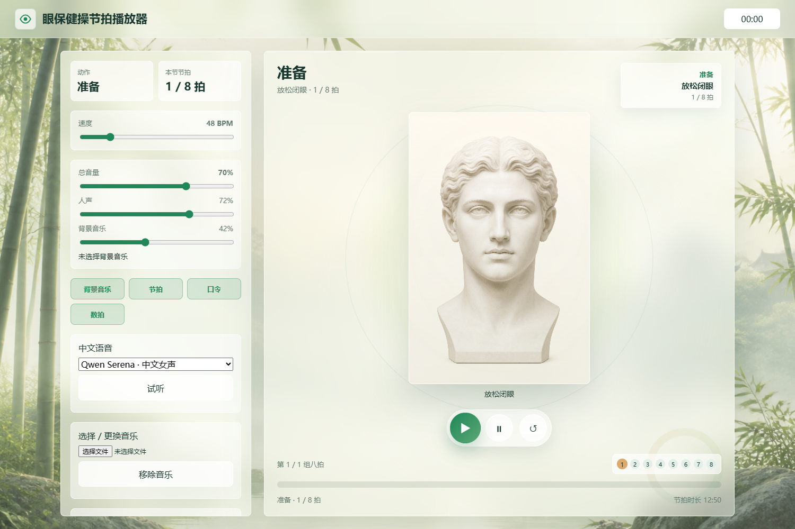

# 眼保健操节拍播放器

跟着动作图和中文数拍做眼保健操。动作编排主要参考**小地雷冬瓜关于干眼症与眼部不适的眼保健操教学**。

[下载播放器](https://github.com/zolicat/eye-exercise-offline/releases/latest)。完整解压 ZIP 后，双击 `index.html` 即可使用，无需联网。

| 可以调整 | 在哪里改 |
| --- | --- |
| 背景音乐 | 播放器不附带音乐。自行下载喜欢的音乐文件（推荐 MP3），在「选择 / 更换音乐」中选入。再次选文件即可换曲，「移除音乐」不会删除电脑上的原文件。音乐和人声可以分别调音量。 |
| 背景图片 | 在「选择 / 更换背景图片」中选一张本地 JPG、PNG 或 WebP。只会更换页面背景，不改变动作图；点「恢复默认背景」即可换回竹林。 |
| 每节八拍数 | 展开「每节八拍数」，分别填写各节的组数。例如填 4 就是 4 个八拍，共 32 拍。点「恢复默认八拍数」可还原。 |

自选素材和设置保存在当前浏览器，不会上传。换电脑后需重新选择。

代码与 OpenAI 生成的图片采用 MIT 许可；预录 Qwen 人声不属于 MIT 授权范围，详见[素材说明](ASSETS.md)。
